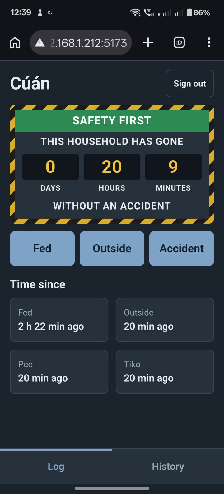
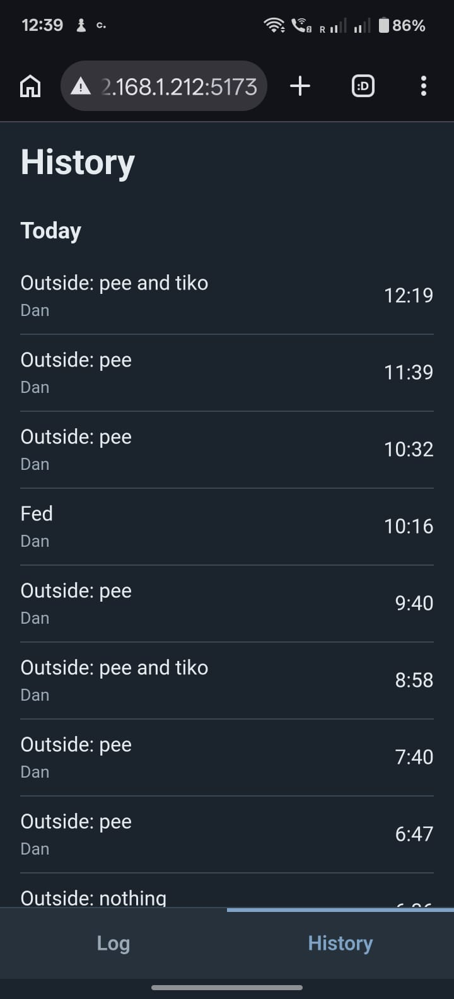

# Puppy tracker

[](https://github.com/danpomahony/puppy-tracker-dev/actions/workflows/ci.yml)

A shared care and training log for a new puppy. Each family member uses the app on their own phone and sees everyone's entries in real time: feeds, outside trips, accidents, and "time since" tiles that answer "when did she last go out?" at a glance.

It is also a portfolio project, so the infrastructure (CI, tests, and later IaC, TLS, backups and monitoring) is treated as seriously as the features.

<p>
  
  
</p>

## How it fits together

```
phone browser ──► Vite dev server :5173 ──/api──► PocketBase :8090 (Docker)
   React + TS         (proxies /api, so the app                SQLite in a volume,
   PocketBase SDK      makes same-origin requests)             migrations in git
```

- **`app/`**: Vite + React + TypeScript, using the PocketBase JS SDK. Realtime subscriptions keep every phone in sync. Linted with oxlint.
- **`backend/`**: [PocketBase](https://pocketbase.io) in Docker. The version is pinned in `compose.yaml`. Schema changes are migrations in `backend/pb_migrations/`, generated by the PocketBase dashboard and committed.
- **`scripts/smoke-test.sh`**: an end-to-end API test (bash, curl, jq) that creates throwaway users and a dog, checks the access rules, then cleans up.
- **`.github/workflows/ci.yml`**: runs lint (warnings fail it), unit tests and build, runs shellcheck on the scripts, then starts the backend and runs the smoke test.
- **`docs/`**: [data model](docs/data-model.md), [workflow](docs/workflow.md) and [architecture decision records](docs/adr/).

The data is one event log with a flexible JSON `data` field, described in [ADR 0001](docs/adr/0001-single-event-log-with-flexible-data.md).

## Run it locally

You need Docker and Node.js.

1. Start the backend:

   ```sh
   docker compose up -d --build
   ```

   The admin UI is at http://localhost:8090/_/. On first visit it asks you to create a superuser. Add a dog and the family's user accounts there.

2. Start the app:

   ```sh
   cd app
   npm install
   npm run dev
   ```

   Open http://localhost:5173.

   To use it from a phone, install [Tailscale](https://tailscale.com) on the host and the phone, then run `tailscale serve --bg 5173`. It prints an HTTPS address on your tailnet, which is what the PWA and offline features need. The app is not exposed to the home network. See [ADR 0002](docs/adr/0002-self-host-at-home-with-https-access.md).

3. Check your changes:

   ```sh
   npm --prefix app run lint && npm --prefix app test && npm --prefix app run build
   PB_SUPERUSER_EMAIL=<superuser email> ./scripts/smoke-test.sh   # prompts for the password
   ```

## Status and plans

The app is in daily use: login, logging feeds, outside trips, accidents, sleep, walks and play, a worksite-style "days since last accident" sign, the Log and History tabs, editing entries, a shared words library, and installation as a PWA over HTTPS.

## Roadmap

Work is tracked in GitHub Issues and a Projects board (see [workflow](docs/workflow.md)). Each milestone below links to its open issues.

**Now: [production infrastructure](https://github.com/danpomahony/puppy-tracker-dev/issues?q=is%3Aissue+milestone%3A%22Production+infra%22)**. Moving from a dev server on a laptop to a deployed, operated service:

1. Automated dependency updates (Renovate)
2. The production host provisioned with infrastructure as code
3. A reverse proxy with automatic TLS
4. Container images built and published from CI, scanned for vulnerabilities and secrets
5. Deploys from CI on a version tag, with secrets encrypted using sops and age
6. Database backups with a restore drill that is actually tested
7. Monitoring and alerting
8. End-to-end browser tests (Playwright)

**Next: [training and words](https://github.com/danpomahony/puppy-tracker-dev/issues?q=is%3Aissue+milestone%3A%22Training+and+words%22)**: practice sessions, word history, and suggesting a word's status from recent results.

**Then:**
- [HTTPS and offline](https://github.com/danpomahony/puppy-tracker-dev/issues?q=is%3Aissue+milestone%3A%22HTTPS+and+offline%22): logging with no signal and syncing later
- [Insights](https://github.com/danpomahony/puppy-tracker-dev/issues?q=is%3Aissue+milestone%3AInsights): patterns from the logged data, such as the best time to go outside after a meal
- [Accounts and households](https://github.com/danpomahony/puppy-tracker-dev/issues?q=is%3Aissue+milestone%3A%22Accounts+and+households%22): invites, and more than one dog

Ideas that are not scheduled live in the [Later](https://github.com/danpomahony/puppy-tracker-dev/issues?q=is%3Aissue+milestone%3ALater) milestone, including a Go backend embedding PocketBase.

## License

[MIT](LICENSE)
